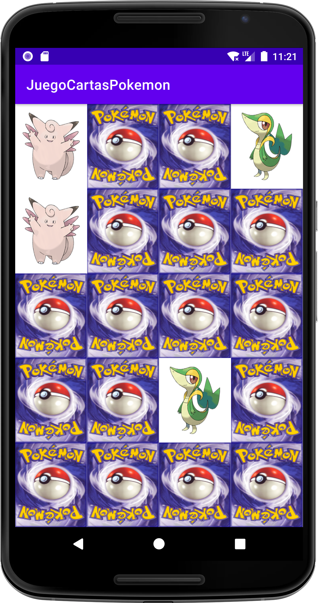
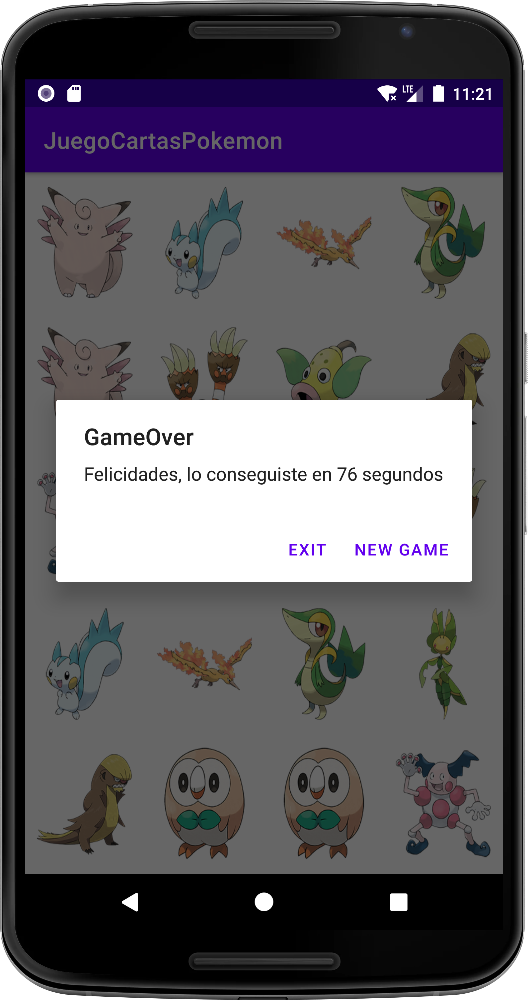

# 🃏 Pokémon Pair Matching — Memory Card Game (Kotlin + Android)

An Android memory game where the player flips cards to find **pairs of matching Pokémon**. Each game uses 10 random Pokémon out of **809**, so no two boards are the same, and the game times how long it takes you to clear it.

> 🎓 **Academic project.** Built for the **Multimedia Programming and Mobile Devices** module (*Programación Multimedia y Dispositivos Móviles, PMDM*) of the **Higher National Diploma in Multiplatform Application Development** (*CFGS Desarrollo de Aplicaciones Multiplataforma, DAM*), 2nd year.

---

## 📸 Screenshots

| Game | Victory |
|---|---|
|  |  |

---

## ✨ Features

- **Random board** on every game: 10 Pokémon are picked from a pool of **809** (Generations I–VII), duplicated and shuffled into a **4 × 5 grid** of 20 cards.
- **Flip two cards per turn**:
    - ✅ Same Pokémon → both cards stay face up and are disabled.
    - ❌ Different Pokémon → both cards flip back after half a second.
- **Input lock** while cards are flipping back, so the player can't open a third card mid-animation.
- **Timer**: the victory dialog shows how many seconds the game took.
- **End-of-game dialog** to start a **New Game** or **Exit**.

---

## 🧰 Tech Stack

| Layer | Technology |
|---|---|
| Language | **Kotlin** |
| Platform | Android (minSdk 21, targetSdk 32) |
| UI | XML layouts: `LinearLayout`, `ImageView` |
| Async | Kotlin Coroutines |
| IDE / build | Android Studio (Gradle) |

---

## 🏗️ Architecture

The whole game runs in a single `MainActivity`, which implements `View.OnClickListener`:

| Method | Responsibility |
|---|---|
| `nuevaPartida()` | Resets the game state and starts the timer |
| `inventaPokemon()` | Shuffles the 809 Pokémon, takes 10, duplicates them and shuffles the board |
| `pintaPokemon()` | Assigns a Pokémon to each card and covers it with the card back |
| `onClick()` | Flips the pressed card and stores the first card of the turn |
| `check()` | Compares both cards and counts the pairs found |
| `taparCartas()` | Flips non-matching cards back after 0.5 s (coroutine) |
| `gameOver()` | Shows the victory dialog with the elapsed time |

### Implementation details

- **Two layers per card**: each `ImageView` uses the Pokémon as its **background** and the card back (`cartapokemon.png`) as its **image**. Flipping a card just makes the image transparent, so the Pokémon underneath shows through.
- **Dynamic drawables**: the Pokémon images are named `pokemon1.png` … `pokemon809.png` (by Pokédex number) and loaded at runtime with `resources.getIdentifier()`.
- **Pair detection with `tag`**: each card stores its Pokédex number in its `tag`, so two cards match when their tags are equal.
- **One listener for 20 cards**: the activity walks the board's vertical `LinearLayout` and its rows, and assigns the same listener to every card.
- **Non-blocking delay**: cards are flipped back from a coroutine, which switches back to the main thread to update the UI.

---

## 📁 Project Structure

```
pokemon-pair-matching-game/
├── app/src/main/
│   ├── java/net/azarquiel/juegocartaspokemon/
│   │   └── MainActivity.kt          # Game logic
│   ├── res/
│   │   ├── drawable/                # 809 Pokémon images + card back
│   │   ├── layout/activity_main.xml # 4 × 5 board
│   │   └── values/                  # Strings, colors, themes
│   └── AndroidManifest.xml
├── screenshots/
└── build.gradle / settings.gradle
```

---

## 🚀 Running Locally

### Prerequisites
- Android Studio
- Android SDK 32
- An emulator or an Android device (Android 5.0+)

### Steps
1. Clone the repository:
   ```bash
   git clone https://github.com/ivangomezr/pokemon-pair-matching-game.git
   ```
2. Open the project in Android Studio and let Gradle sync.
3. Press **Run ▶** and choose an emulator or a connected device.

---

## 🙋 Author

**Iván Gómez** — [@ivangomezr](https://github.com/ivangomezr)

Developed as coursework for the *Multimedia Programming and Mobile Devices* module, DAM.